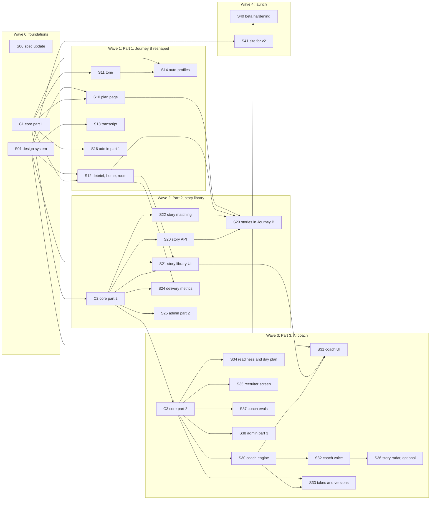

# v2 execution plan

How to build v2.0 with several Claude Code sessions in parallel. The scope and decisions are in
the v2 plan doc (https://claude.ai/artifact/BSjZFLreXzRgqapKdqz87V). Each session gets one prompt
file from `docs/v2/prompts/` plus `docs/v2/prompts/00-common.md`.

## How it runs

- **One core lane, run in order.** C1, C2 and C3 are the only sessions that edit `packages/core`
  (contracts, models, migrations, gateway roles). Each is a small PR that merges before the
  feature sessions that need it. Their migrations chain in that order, so no `down_revision`
  rebases are needed.
- **Feature lanes in parallel.** Within a wave, sessions own different folders, so they can run
  at the same time in separate worktrees. They meet only at the shared hot spots listed in
  `00-common.md`.
- **The core lane runs one wave ahead.** C2 starts as soon as C1 merges, while wave 1 is still
  running, and C3 starts as soon as C2 merges.
- **Hidden until launch.** New screens that replace a v1 screen sit behind the runtime setting
  `v2_enabled` (C1), so `main` stays deployable for v1 throughout.
- **Suggested concurrency:** up to 6 sessions at once. Merge order inside a wave does not matter
  unless a "Waits for" entry says so.

## Waves



| ID | Session | Wave | Waits for (merged) | Owns | Requirement IDs |
| --- | --- | --- | --- | --- | --- |
| S00 | Spec update | 0 | nothing | `docs/spec.md`, `docs/v2/` | all v2 IDs written into the spec |
| S01 | Design system and app shell | 0 | nothing | `apps/web/src/styles.css`, `apps/web/src/components/{Layout,BrandMark,ui}.tsx`, `apps/web/src/theme/`, web fonts, `apps/admin/src/styles*` | UI-1, UI-2 |
| C1 | Core part 1 | 0 | nothing | `packages/core`, `schemas/` | TN-1 (contract), AP-1 (model), FL-1 |
| S10 | Interview plan page | 1 | S01, C1 | `apps/web/src/pages/plan/`, `apps/api/src/strong_api/plan/` | PP-1, PP-2, PP-4 |
| S11 | Tone, end to end | 1 | C1 | tone validation in `apps/api/src/strong_api/sessions/`, the tone parts of `apps/worker/src/strong_worker/gap/brief.py`, `prompts/planner/interviewer_brief*`, `prompts/interviewer/turn*`, their fixtures | TN-1, TN-2, TN-3 |
| S12 | Debrief, home and live room | 1 | S01, C1 | `apps/web/src/pages/{DebriefPage,DashboardPage}.tsx`, `apps/web/src/pages/home/`, `apps/web/src/session/`, DB-1 and DB-2 additions in `apps/api/src/strong_api/scoring/router.py` | DB-1, DB-2, PP-3, LR-1, AV-1 |
| S13 | Transcript view | 1 | S01 | `apps/api/src/strong_api/reports/transcript.py`, `apps/web/src/pages/transcript/` | TR-1, TR-2 |
| S14 | Auto-profiles | 1 | C1; brief hook waits for S11 | `apps/worker/src/strong_worker/profiles/`, `prompts/extractor/auto_profile*`, one auto-profile call in `apps/worker/src/strong_worker/gap/brief.py` | AP-1, AP-2 |
| S16 | Admin portal, part 1 | 1 | C1 | `apps/admin/`, `apps/api/src/strong_api/admin/` | AD-3, AP-3 |
| C2 | Core part 2 | 2 (starts during wave 1) | C1 | `packages/core`, `schemas/` | ST-1 (contract), DM-1 (contract) |
| S20 | Story API, export and delete | 2 | C2 | `apps/api/src/strong_api/stories/`, the story part of `apps/api/src/strong_api/account/` | ST-1, ST-2 (API) |
| S21 | Story library UI | 2 | S01, C2, S12; S20 for live data | `apps/web/src/pages/stories/`, `apps/web/src/pages/home/StoryLibrary*` | ST-3, ST-4 |
| S22 | Story matching and the Proven rule | 2 | C2 | `prompts/planner/story_fit*`, `prompts/scorer/` (story fields), `apps/worker/src/strong_worker/scoring/stories.py`, a story fit step in `apps/worker/src/strong_worker/gap/` | ST-5 (engine), ST-6 (engine), ST-7 |
| S23 | Stories in Journey B | 2 | S10, S12, S20; S22 for live data | `apps/web/src/pages/plan/StoryFit*`, `apps/web/src/pages/debrief/Story*`, a story fit endpoint file in `apps/api/src/strong_api/plan/` | ST-2 (UI), ST-5 (UI), ST-6 (UI) |
| S24 | Delivery metrics | 2 | C2, S12 | `apps/worker/src/strong_worker/scoring/delivery.py`, `apps/web/src/pages/debrief/Delivery*` | DM-1, DM-2 |
| S25 | Admin portal, part 2 | 2 | C2, S16 | `apps/admin/`, `apps/api/src/strong_api/admin/` | AD-4 |
| C3 | Core part 3 | 3 (starts during wave 2) | C2 | `packages/core`, `schemas/`, `config/` (coach role) | CO-1, RS-1 (enum), RD-1 (contract) |
| S30 | Coach engine (text) | 3 | C3 | `apps/api/src/strong_api/coach/`, `prompts/coach/` (except versions), gateway fixtures for coach | CO-2, CO-3, CO-4, CO-5 |
| S31 | Coach UI | 3 | S01, S21; S30 for live data | `apps/web/src/pages/coach/`, takes and versions UI in `apps/web/src/pages/stories/`, coach links on Home and the plan page | CO-2 (UI), CO-7 (UI), CO-8 (UI) |
| S32 | Coach voice | 3 | S30 | `apps/voice/src/strong_voice/coach*`, a voice hook file in `apps/web/src/pages/coach/` | CO-6 |
| S33 | Takes and story versions | 3 | C3, S30 | `apps/api/src/strong_api/takes/`, `apps/worker/src/strong_worker/scoring/takes.py`, `prompts/coach/story_versions*` | CO-7, CO-8 |
| S34 | Practice readiness and day plan | 3 | C3, S10 | `apps/api/src/strong_api/plan/readiness.py`, `apps/api/src/strong_api/plan/day_plan.py`, `apps/web/src/pages/plan/Readiness*`, `DayPlan*` | RD-1, RD-2, RD-3 |
| S35 | Recruiter screen | 3 | C3 | `prompts/{planner,interviewer,scorer}/recruiter_screen*`, their fixtures, one entry in the plan page's type list | RS-1, RS-2 |
| S36 | Story radar (optional) | 3 | S32, a passing latency test | `apps/voice/src/strong_voice/radar*`, `apps/web/src/session/StoryRadar*` | SR-1 |
| S37 | Coach evals | 3 | C3; S30 for real runs | `evals/` (coach suites), `apps/sim/` coach scenarios | CO-9 |
| S38 | Admin portal, part 3 | 3 | C3, S25 | `apps/admin/`, `apps/api/src/strong_api/admin/` | AD-5 |
| S40 | Beta hardening and launch gate | 4 | all of wave 3 | tests across the repo, `infra/`, `docs/v2/beta.md` | the launch gate |
| S41 | Marketing site for v2 | 4 | S01 | `apps/site/` | UI-3 |

S16, S25 and S38 all own `apps/admin`; they run in different waves, so they never overlap.
S12, S21 and S34 all touch Home: S12 builds the page with empty sections, and the others add
components into them. S10, S23 and S34 all touch `apps/web/src/pages/plan/` and `apps/api/src/strong_api/plan/`; S23 and S34 add
new files only. S22, S24 and S33 each add their own module under `apps/worker/.../scoring/` and
one call in the scoring pipeline; the second and third to merge rebase that one line.

## Requirement IDs

S00 writes these into `docs/spec.md`. Sessions use them in test names from day one.

**Part 1: Journey B reshaped**

| ID | Requirement |
| --- | --- |
| UI-1 | The app uses the v2 visual language: Geist and Geist Mono, the violet action color, teal for interview prep, color-coded story parts that always carry a text label. Contrast meets WCAG AA. |
| UI-2 | A left rail nav: Home, Stories, Interviews, Questions, Account. Stories shows only when `v2_enabled` is on. |
| FL-1 | Runtime setting `v2_enabled` (default off) gates every v2 screen that replaces a v1 screen. |
| PP-1 | One interview plan page per job and resume pair replaces the separate gap analysis, rehearsals (PR-3) and session setup pages. It shows what the company will test (profile weights), where they will probe (GA-2), earlier debriefs and the next rehearsal setup. |
| PP-2 | The plan page and the interview card show the days left to `interview_date` when it is set, and ask for it when it is not. |
| PP-3 | Home shows one card per interview (company, role, match score, days left) and the PR-2 next-session advice as one sentence from the coach. |
| PP-4 | The plan page's setup keeps every v1 option: type, Custom, difficulty, tone, mode, 30 or 45 minutes. |
| TN-1 | The user picks a tone: "As the company" (the default, from the profile persona), Warm, Neutral or Direct. Tone is stored on the session. |
| TN-2 | The chosen tone reaches the brief and the live interviewer; difficulty still controls probes and pushback (IV-4). Tone never changes scoring. |
| TN-3 | Generic mode uses Neutral as the default tone. |
| DB-1 | The debrief shows the hire signal of the previous session for the same pair and the change. |
| DB-2 | The debrief shows how many answers met the bar (a rubric score of 3 or more). |
| LR-1 | The live room shows how long the current answer has run against a suggested length for the question type. |
| AV-1 | The 3D avatar is off behind a flag; its components and tests stay. The live room shows the interviewer state without it. |
| TR-1 | The candidate can read the transcript of any finished session from its debrief. |
| TR-2 | The transcript is included in export and removed by delete (AC-1). |
| AP-1 | When a job's company is outside the curated list, a background job builds a short auto-profile from the posting's domain pages, cached per company and labeled "auto-generated". |
| AP-2 | An auto-profile adds a summary to the brief only. It never changes scoring weights and adds no interview latency. |
| AP-3 | Admins review auto-profiles in a queue: approve, edit or retire. Only approved ones reach a brief. |
| AD-3 | The admin portal shows plan page usage and the tone and difficulty mix across sessions. |

**Part 2: Story library**

| ID | Requirement |
| --- | --- |
| ST-1 | A story has a title, five parts (context, stakes, action, result, reflection), skill tags, a status (Draft or Proven) and its source. Stories are user-owned, in export and delete. |
| ST-2 | "Save as a story" on any debrief answer creates a Draft story from the answer, with skill tags from the scored competencies. |
| ST-3 | The story workbench lists stories and edits a story part by part. |
| ST-4 | Home shows the story library and a map of the skills the stories cover, with gaps marked. |
| ST-5 | The plan page shows a story fit table: for each skill the interview will test, the best story and whether it is strong, thin or missing. |
| ST-6 | The debrief shows the story used for each answer and sends that answer's fix to the story as a note. |
| ST-7 | A story becomes Proven when a Realistic answer that used it scores 3 or more. |
| DM-1 | Delivery metrics per answer from turn timestamps and text: speaking pace (words per minute) and filler words per minute. No audio is used or kept. |
| DM-2 | The debrief shows the delivery metrics with a plain note when they are outside a normal range. |
| AD-4 | The admin portal shows story save rate, stories per user, Draft to Proven rate and delivery metric trends, aggregate only, with no story text. |

**Part 3: AI coach**

| ID | Requirement |
| --- | --- |
| CO-1 | `coach` is a gateway role, mapped in every `config/models.*.yaml`, with prompts, fake fixtures and a conformance suite. |
| CO-2 | A text coach session helps the candidate build one story through conversation. |
| CO-3 | After each candidate turn the story's parts update; the UI shows which parts are filled. |
| CO-4 | The coach asks for what is missing using the IV-3 rules: the candidate's own role, a measurable result, a concrete example, trade-offs. |
| CO-5 | The candidate picks a coaching style, gentle or direct. |
| CO-6 | Coach sessions also run by voice on the existing voice loop. |
| CO-7 | A take is one spoken or typed telling of a story, scored by the existing scorer on the story's skills (1 to 4). |
| CO-8 | The coach produces a 60-second and a full version of a story from the candidate's own words. |
| CO-9 | The coach never adds facts the candidate did not say; an eval suite checks this. |
| RD-1 | Practice readiness per skill for an interview, from Realistic sessions only, labeled as a practice estimate. |
| RD-2 | A day-by-day plan to `interview_date`, built from GA-3, PR-2 and the open gaps. |
| RD-3 | The practice-estimate notice shows on every screen that shows readiness. |
| RS-1 | Recruiter screen is a fifth interview type, with its own competencies. |
| RS-2 | Recruiter screen has its own brief, questions and rubric variants. |
| SR-1 | Optional. In Coach mode the live room shows which story part the candidate is on, computed off the interviewer's path; it ships only if p95 voice latency does not rise. |
| AD-5 | The admin portal shows coach sessions and minutes, cost per coach session, coach eval results, readiness by skill, and the recruiter screen brief and rubric. |
| UI-3 | The marketing site describes v2 and uses the v2 visual language. |

## Merge order and checkpoints

1. Wave 0: S00, S01 and C1 in any order.
2. Wave 1 starts when C1 (and S01, for UI sessions) has merged. Start C2 at the same time.
3. Checkpoint A, end of Part 1 (target end of February 2027): with `v2_enabled` on in staging,
   a user goes Home, plan page, rehearsal, debrief, transcript without a v1 page in between.
4. Wave 2 starts when C2 has merged; start C3 at the same time.
5. Checkpoint B, end of Part 2 (target end of April 2027): a debrief answer is saved as a story,
   edited in the workbench, shows in the plan's story fit and turns Proven after a Realistic
   session.
6. Wave 3 starts when C3 has merged.
7. Checkpoint C, end of Part 3 (target end of June 2027): a coach session builds a story, a take
   is scored, and readiness updates. Coach evals pass.
8. Wave 4: S40 runs the closed beta and the launch gate; S41 updates the site.

## Starting a session

Open a new Claude Code session in its own worktree on `main` and paste:

```text
Read docs/v2/prompts/00-common.md, then docs/v2/prompts/<file>.md, and do that work.
```

Run each prompt once. To continue a stopped session, open the same branch and add:
"Continue from the branch; read the open PR first."
